# MOH:AA Model Viewer & Map Viewer

Two view-only tools for *Medal of Honor: Allied Assault (2002)* in one download. Both read
the game's own `.pk3` files, share one Python setup and launcher style, and build
self-contained HTML pages that open in the launcher's embedded 3D pane or in any browser.

* **MOHAA Model Viewer** opens any `.skd` / `.tik` with its animations, tags, shaders and
  live particle effects, aiming at exact in-game parity: the running asset that LightRay3D
  and Milkshape 3D can't show.
* **MOHAA Map Viewer**, the `.bsp` viewer, opens any compiled `.bsp`, turns it back into
  `.map` source and shows the whole map textured and lit like the game, or opens a `.map`
  directly: a modern, view-only stand-in for MOHRadiant.

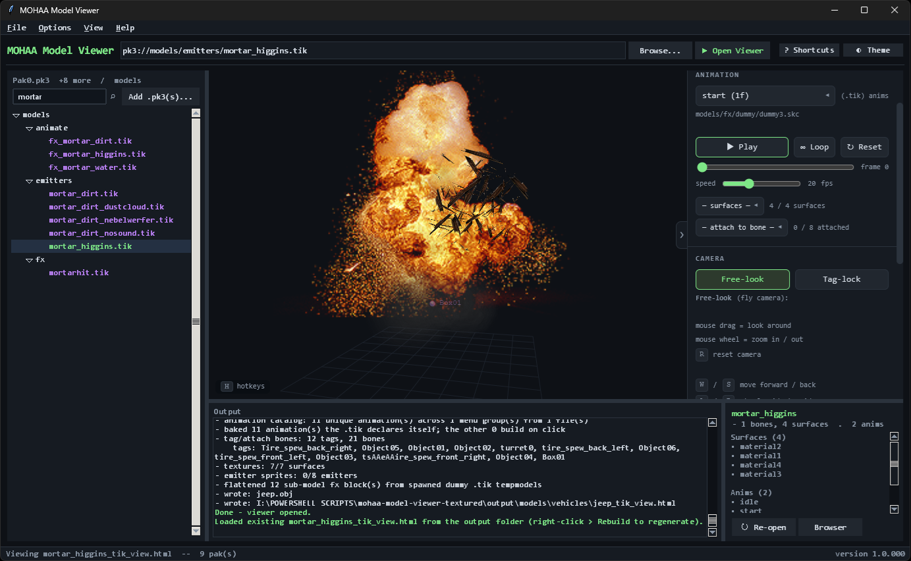 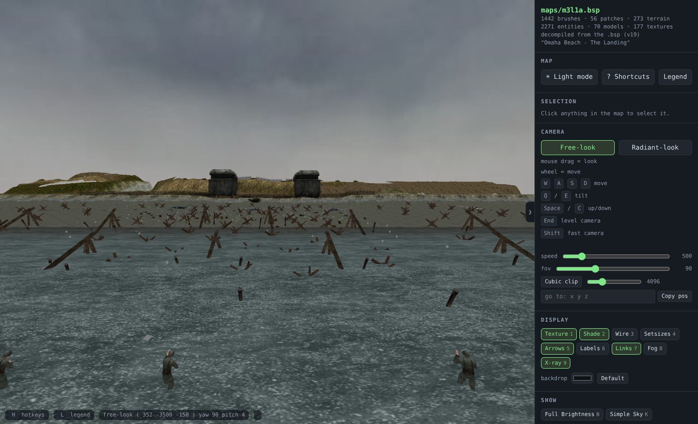

# Table of Contents

### [How To Install / Uninstall](https://github.com/searingwolfe/mohaa-model-viewer?tab=readme-ov-file#how-to-install--uninstall-1)<br>
## [MOHAA Model .tik Viewer](https://github.com/searingwolfe/mohaa-model-viewer?tab=readme-ov-file#mohaa-model-viewer)<br><br>[MOHAA Map .bsp Viewer](https://github.com/searingwolfe/mohaa-model-viewer?tab=readme-ov-file#mohaa-bsp-viewer)<br><br>
### [Updating](https://github.com/searingwolfe/mohaa-model-viewer?tab=readme-ov-file#updating-1)<br>
### [Where Your Files Go](https://github.com/searingwolfe/mohaa-model-viewer?tab=readme-ov-file#where-your-files-go-1)<br>
### [Privacy & Security](https://github.com/searingwolfe/mohaa-model-viewer?tab=readme-ov-file#privacy--security-1)<br>
### [Licence & Legal](https://github.com/searingwolfe/mohaa-model-viewer?tab=readme-ov-file#licence--legal-1)<br>
### [For Developers](https://github.com/searingwolfe/mohaa-model-viewer?tab=readme-ov-file#for-developers-1)<br>
### [Contact & Credits](https://github.com/searingwolfe/mohaa-model-viewer?tab=readme-ov-file#contact--credits-1)

# How To Install / Uninstall

**Requirements** (the same for both viewers):

* **Python 3.8 or newer** (3.11+ recommended), with the `tkinter` GUI module.
* **Pillow 10.3 or newer**: required. MOHAA textures are `.tga` and nothing else decodes
  them. (Pillow 10.3 is also why Python 3.8 is the minimum.)
* Your own legally obtained copy of the game, for its `.pk3` files.
* Optional, Windows 8.1 and newer: an embedded 3D pane instead of a browser tab
  (`pythonnet`, `pywebview==4.4.1`, `tkwebview2` and the Microsoft Edge WebView2 Runtime,
  which ships with Windows 10 and 11).
* Without the pane, pages open in your browser. The Map Viewer needs WebGL 2, which every
  current browser has; the Model Viewer falls back to a 2D renderer without WebGL.

The packages are listed in [`docs/requirements.txt`](docs/requirements.txt). On Windows,
the RUN `.bat` files check for all of these and install what's missing.

## Windows

* Click the green `<> Code` button and choose `Download ZIP`. <br>
Extract the `mohaa-model-viewer-main` folder anywhere on your PC.

* Start a viewer with its RUN `.bat`, or drag a file onto the `.bat` to open that file
straight away:
  * **`RUN -- Medal of Honor Model Viewer.bat`** for models (`.skd` / `.tik`);
  * **`RUN -- Medal of Honor Map Viewer.bat`** for maps (`.bsp` / `.map`).

  Before opening its launcher, each one:
  1. looks for **Python 3.8 or newer with tkinter**. If there isn't one, it asks whether
     to install it now: **Y** runs `bin\python_installer_updater.bat` (below), **N** closes
     the window so you can install Python yourself from
     [python.org](https://www.python.org/downloads/) (tick "tcl/tk" in the installer);
  2. installs **Pillow** if it's missing (required for textures);
  3. installs the **embedded 3D pane** packages if they're missing (optional; on
     Windows 8.1 and newer);
  4. tells you if the Microsoft Edge WebView2 Runtime is missing, in which case pages
     open in your browser.

  The `.bat` file then opens the launcher and its own window closes.

* **`bin\python_installer_updater.bat`** installs a Python that suits your Windows
version and CPU (Windows 7 → 3.8, Windows 8/8.1 → 3.11, Windows 10/11 → latest) for
your user account only, so it normally needs no administrator rights. It verifies the
installer's Authenticode signature before running it, then installs the packages. The
RUN `.bat` files offer to run it for you, and you can also run it on its own to update
the packages. <br>
It deliberately **does not modify your `PATH`**: Python's own installer handles that,
and hand-editing the registry `PATH` is how environments often get broken.

* If Windows blocks a `.bat` (SmartScreen or Smart App Control): <br>
Right-click the `.bat` file → Properties → General tab → Security: [✓] Unblock → OK.

* Once a launcher is open, use File → `Add .pk3 pak(s)...` and select all the game's
`.pk3` files (Pak0.pk3 and up, plus any expansion or mod paks; later paks override
earlier ones). <br>
Models, maps, scripts and textures are spread across them, so load them all together.
Each viewer remembers its own list.

## macOS and Linux

```sh
brew install python-tk           # macOS (or use the python.org installer, which bundles Tk)
sudo apt install python3-tk      # Debian / Ubuntu / Mint
sudo dnf install python3-tkinter # Fedora / RHEL
sudo pacman -S tk                # Arch

pip3 install "Pillow>=10.3.0"
python3 bin/mohaa_launcher.py        # the Model Viewer
python3 bin/mohaa_map_launcher.py    # the Map Viewer
```

The embedded 3D pane is Windows-only. Everywhere else, pages open in your default
browser: same viewer, same output.

## Uninstall

Close both programs (each deletes its temporary workspace when it closes; File →
`Clear %temp% files` removes any left behind by a crash), then delete the folder.
Everything the programs keep is inside it, in `output/`
(see [Where Your Files Go](#where-your-files-go-1)). Python and its packages stay
installed; remove Python from Windows Settings → Apps if nothing else needs it.

# MOHAA Model .tik Viewer

A browser-based 3D asset viewer aiming at exact in-game visual parity across every asset
type the engine ships: skeletal models, animations, vehicles, weapons, projectiles,
static props, and the particle emitters and FX effects that existing tools do not handle.

Start it with **`RUN -- Medal of Honor Model Viewer.bat`** (or drag a `.skd` / `.tik`
onto it), load your `.pk3` archives, browse the model tree, and open any `.skd` or `.tik`
in a self-contained HTML viewer with animation playback, tag display, texture resolution
through the shader chain, and live particle effects.

## Why this exists

Plenty of tools open MOHAA's static geometry: vehicles, weapons and props load fine in
LightRay3D or Milkshape 3D. None of them show you a *running* asset: the particle
emitters, the FX scripts, the explosions, a skeletal model actually playing its animation
with its effects firing on the right frames. This viewer does, rebuilding each effect from
the `.tik` / `.shader` commands the way the engine would, so what you see on screen is
what the game draws.

## Features

**Loading & browsing**

* Open one or more `.pk3` archives and navigate the `models/` tree, or drag a
  loose `.skd` / `.tik` onto the launcher (or onto the RUN `.bat`).
* Loaded paks and preferences are remembered between sessions, with a
  recent-files list, tree search (`Ctrl+F`) and Explorer-style keyboard
  navigation.
* Select several files to build them in one batch, or drag a file out of the
  window to open it in its own browser tab.
* Right-click a file to open a `.tik` in your text editor, or a `.skd` in
  LightRay3D / Milkshape 3D (set them under Options → Change Text Editor /
  Change Legacy Model Viewer).
* Every built model is also exported as a Wavefront `.obj` you can open in other 3D tools.

**Rendering & animation**

* Skeletal `.skd` / `.skb` models with textures resolved through the full
  `.shader` chain, plus `.skc` / `.tik` animation playback: play/pause, loop,
  reset, per-frame scrub and a speed control.
* The animation browser follows the model's own `$include` / `includes{}`
  structure, so you can reach every anim the asset can play. The first 150 are
  built into the page (adjustable in Options); the rest are built the first time
  you pick them.
* **Particle emitters, FX scripts and explosions**, rebuilt from the effect
  commands and fired on their real frames: the part other tools skip.
* Show or hide individual surfaces, starting from what the `.tik` hides at spawn;
  an animation's own surface commands apply as it plays.
* Hang other models off any bone or tag with **attach-to-bone**, each with its
  own editable scale, offset (in `.tik` units) and angles.
* WebGL rendering with a real depth buffer, or the 2D-canvas renderer (switch with
  View → Viewer renderer in the launcher, or Display → WebGL in the viewer; 2D is used
  automatically when WebGL isn't available).

On-demand animations and attach-to-bone need the launcher's embedded pane; a page
opened in a plain browser shows everything already built into it.

**Inspect & tweak**

* Display toggles: Texture, Mesh, Wire, Setsizes, Nodes, Labels, Face Anims,
  Corona orbit, WebGL and, for trees, the long-range Tree Sprite stand-in.
* **Edit a model's `setsize` bounding box live**: a pencil toggle on the setsize
  line turns the two `( x y z )` triples into number fields that redraw the red
  box as you type, then revert to the file's original values when you toggle it
  back off. A model with no `setsize` shows a `( 0 0 0 ) ( 0 0 0 )` placeholder
  you can fill in the same way.
* Copy the `setsize` line, or any attach-to-bone `scale / offset / angles` row,
  as one flat line in MOHAA `.tik` spacing, ready to paste straight into a
  script.
* Free-look (WASD fly) and Tag-lock (orbit a clicked tag) cameras; tag/bone nodes
  and labels with a Tags-vs-Bones filter.
* An entity placement-angle (pitch / yaw / roll) dial that snaps to quarter
  turns, with a pencil for typing any angle.
* Light / dark theme and a custom backdrop colour, plus a full keyboard-shortcut
  set (`H` in the viewer, `F1` in the launcher).

**Self-contained by design**

* Each generated page is a single `.html` file: textures embedded as `data:`
  URIs, a restrictive Content-Security-Policy, and no network access at all
  (see [Privacy & Security](#privacy--security-1)).

## Model Viewer screenshots

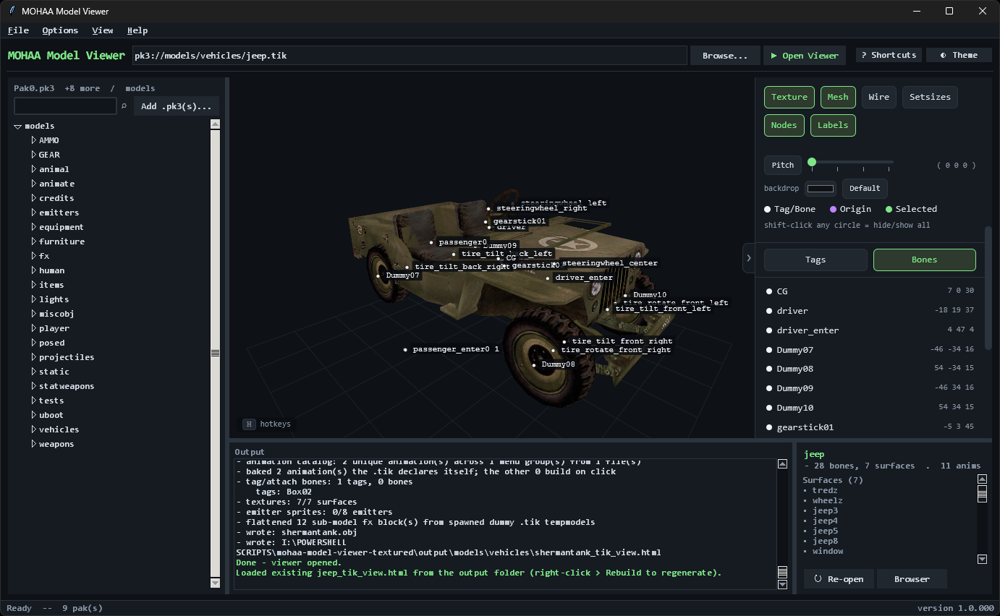
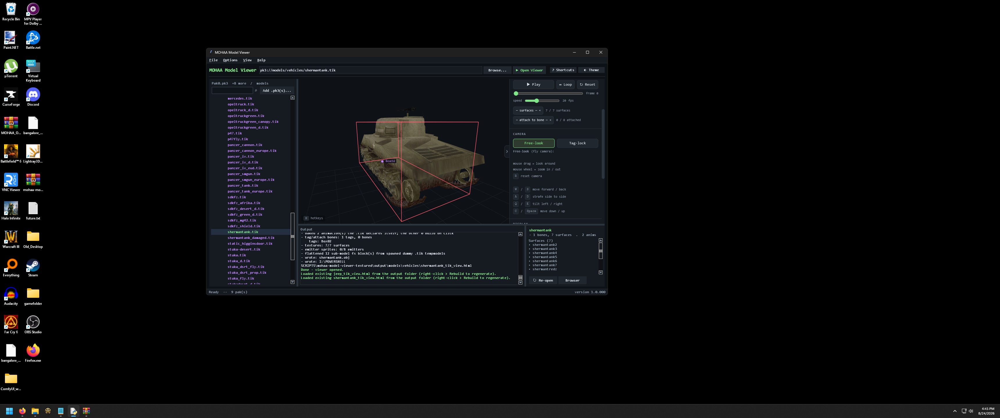
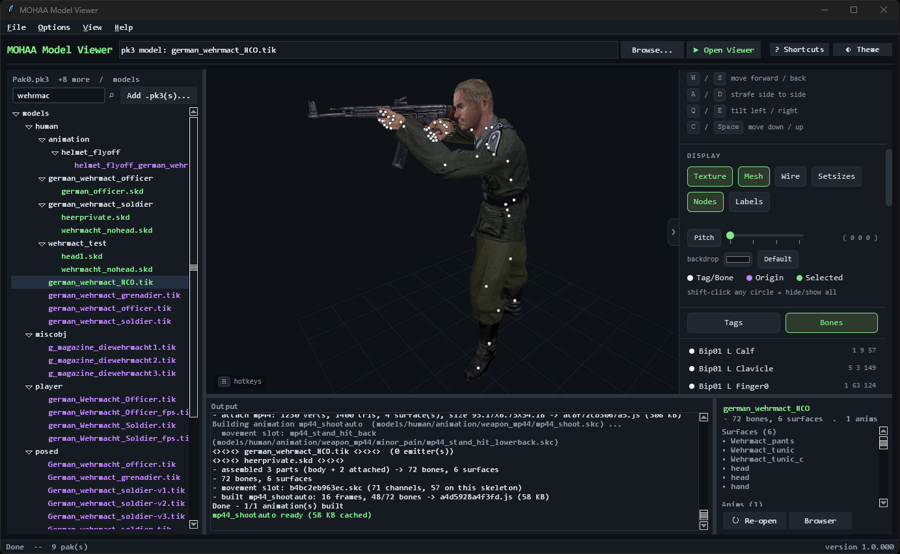
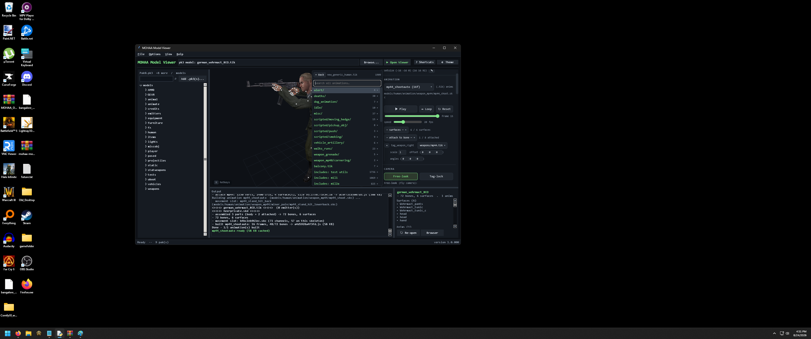
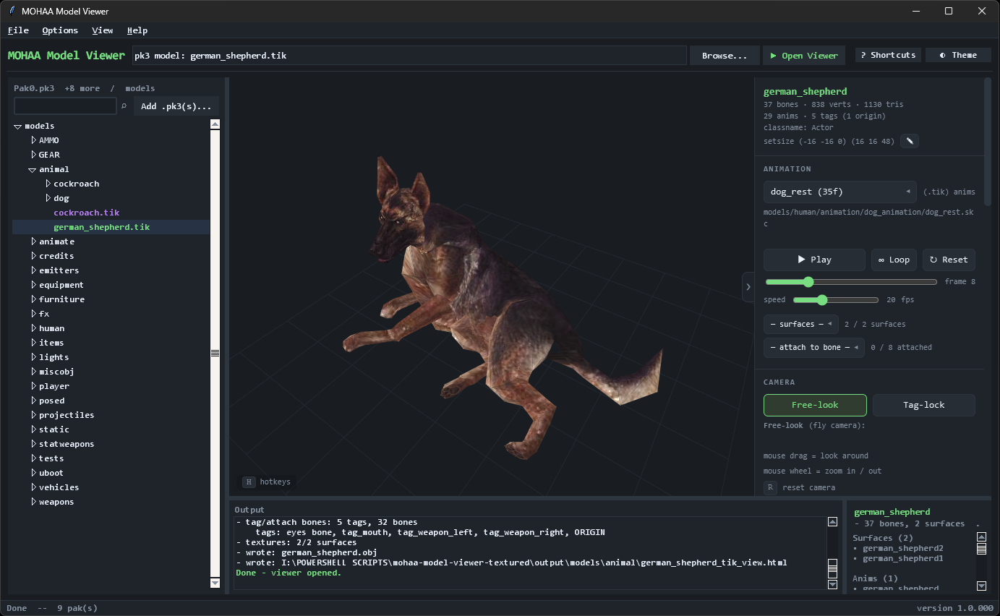
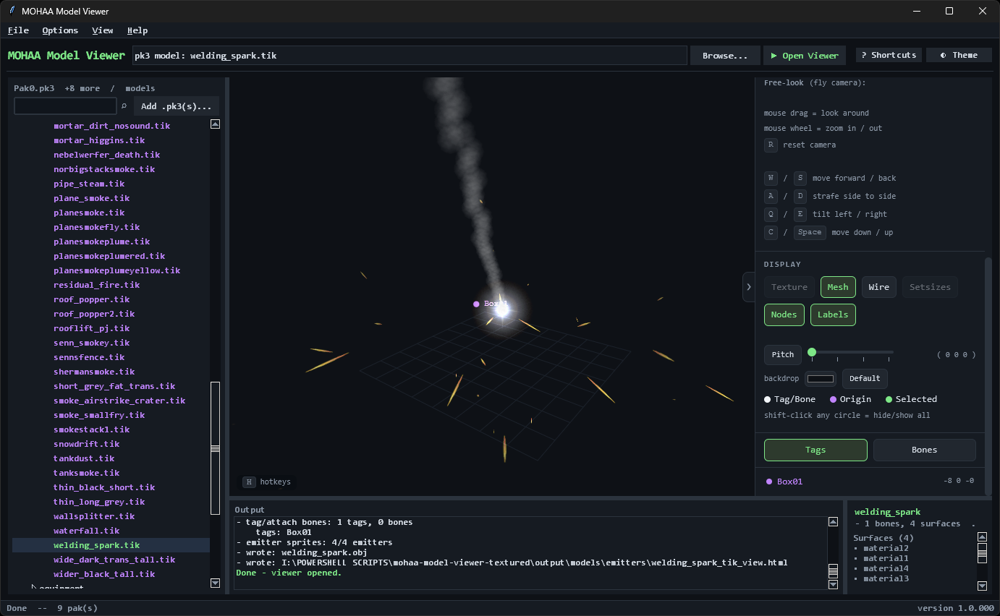

# MOHAA Map .bsp Viewer

**MOHAA Map Viewer** opens the game's maps. A compiled `.bsp` is decompiled back into
`.map` source and shown whole: textured, lit like the game, every entity one click away.
A `.map` source opens directly. It's a modern, view-only stand-in for MOHRadiant: nothing
is ever written back to a map.

Start it with **`RUN -- Medal of Honor Map Viewer.bat`** (or drag a `.bsp` / `.map`
onto it), add your `.pk3` paks, and open any map from the `maps/` tree (`dm`, `obj`, the
single-player levels), or a loose `.bsp` / `.map` from disk with File → `Open File...`.

## Why this exists

MOHRadiant, the game's level editor, only opens `.map` sources, and the game's maps, like
most custom maps, ship only as compiled `.bsp` files. This viewer turns any `.bsp` back
into `.map` source and lets you explore the map in a modern 3D view, the way the game
draws it or the way MOHRadiant does, with every entity, trigger, path node and brush one
click away: its targetname, origin, `setsize`, targets and ready-to-paste script lines.

## Features

**Opening maps**

* **`.bsp` and `.map`.** A compiled `.bsp` is turned back into `.map` source by a
  built-in decompiler: brushes with their texture alignment recovered from what the game
  actually draws, curved patches, terrain (with its cut-away holes), entities and static
  models. The `.map` is saved next to the page; a `.map` of your own next to a `.bsp` is
  never overwritten.
* Right-click a `.bsp` → **Decompile to .map only**, or decompile and open the `.map` in
  your text editor. A map's `.scr` scripts are in the tree too: double-click one to open
  it in your text editor.
* Select several maps, or right-click a folder, to build them in one batch.

**Seeing the map**

* **The whole map, textured:** brushes, curved patches, LOD terrain, placed and static
  models, and every entity, with point entities drawn the way MOHRadiant draws them
  (path nodes coloured by their targetname and spawnflags, facing arrows, stand-in cubes).
* **Lit like the game:** a `.bsp` opens with its own lightmaps, vertex light, baked
  static-prop light, light-grid model colours and sky box, so you see what a player
  sees. **Full Brightness** (`B`) switches to MOHRadiant's flat, fully bright look.
  The sky is drawn behind everything, as in game; **Simple Sky** (`K`) shows
  MOHRadiant's solid, tiled sky brushes instead.
* **MOHRadiant-style filters** (`Alt+1` … `Alt+0`, `Ctrl+D / H / M / R / T / P / K`) for
  caulk, clips, triggers, hints, AI nodes, lights, details, terrain, sky and more, with
  **In-game look** and **Editor look** presets, plus setsize boxes, target arrows,
  labels, X-ray, fog and cubic clipping.
* **Legend** (`L` in the viewer, `F2` / Help → Legend in the launcher): what every
  colour, marker, path-node border and editor brush (clip, trigger, hint, vis,
  areaportal...) means.

**Moving and finding**

* **Two cameras:** Free-look (the Model Viewer's WASD fly, with `Q` / `E` tilt) and
  **Radiant-look**, which flies with MOHRadiant's own keys and right-drag. `V` switches
  between them.
* **Click anything:** a face, brush, patch, model or entity. `N` or `Ctrl+click` opens
  its card: every key, origin, angles, targets and targetnames, spawnflags, the
  `setsize` (taken from its brushes for triggers and doors) and ready-to-paste script
  lines. `Alt+click` selects everything of the same kind, `Ctrl+Alt+click` a whole path
  (a node's `target` chain, before and after it), and `Ctrl+Shift+click` shows a face's
  texture.
* **Find** any class, targetname, key or texture (`Ctrl+F`), or browse every class and
  texture the map uses.

It uses the same Python and packages as the Model Viewer, and both can be open at once.
Press `H` in the viewer or `F1` in the launcher for every shortcut.

**Planned:** reading a map's other files too: its `.pth` (AI path data) and `.min` files,
and its `.scr` level scripts, so the models and changes a script adds at run time can be
shown in the map.

## Map Viewer screenshots

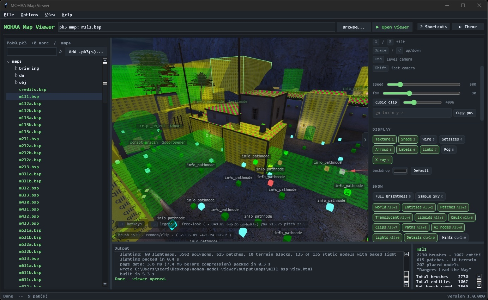
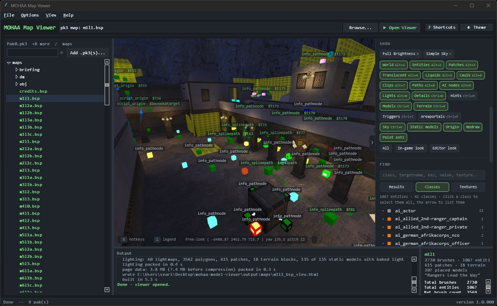
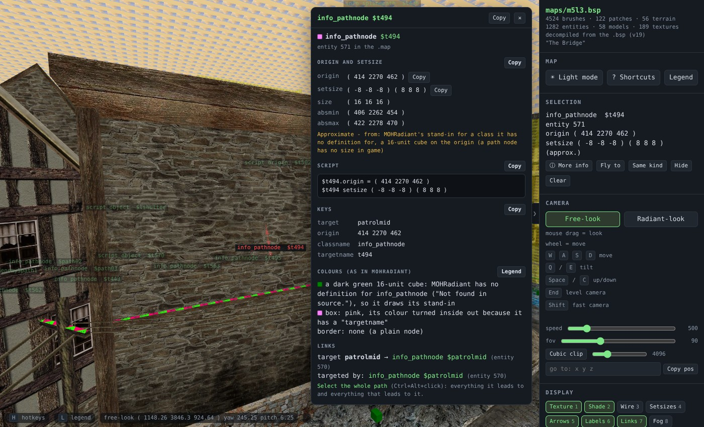
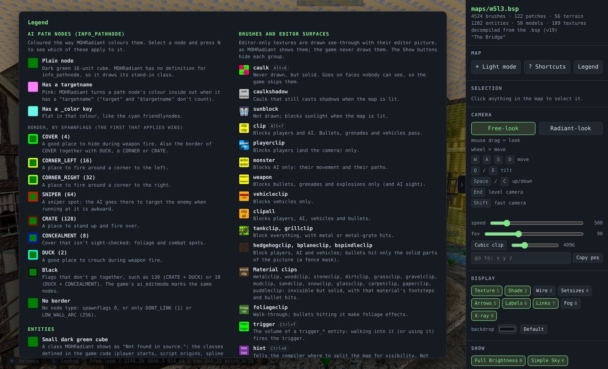
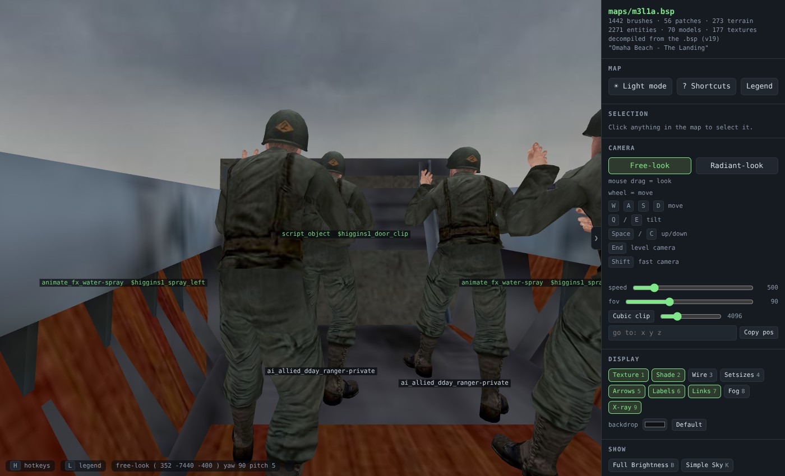

# Updating

**Help → Check for updates** (in either launcher) compares your version with the latest
one in this repository and, if you choose, downloads the new version's files, copies them
over the program folder, and restarts. Both viewers update together, since they share the
folder. Your settings and built pages in `output/` are left alone.

# Where Your Files Go

| | Model Viewer | Map Viewer |
|---|---|---|
| Settings | `output/mohaa_viewer_config.json` | `output/mohaa_map_viewer_config.json` |
| Console log | `output/output_console.log` | `output/output_console_map.log` |
| Built pages | `output/models/`, mirroring the pak's folders; files opened from disk go to `output/standalone/` | `output/maps/`, with each decompiled `.map` beside its page; files opened from disk go to `output/maps_standalone/` |
| Scratch space | a `mohaaview_*` folder in your system temp folder | a `mohaamap_*` folder in your system temp folder |

`output/` is the folder next to `bin/` (in a flat / portable install, the scripts' own
folder). The built-pages folder can be changed under Options. On Windows, the embedded
pane also keeps its browser files in `output/webview2/`.

**File → Clear built models** (or **Clear built maps**) and **Clear %temp% files** remove
the built pages and the scratch space. Clear built maps deletes only the pages and `.map`
files the Map Viewer wrote: a decompile never replaces a `.map` of your own (it's saved
as `<name>_decompiled.map` instead).

# Privacy & Security

**Neither program collects or sends anything.** No telemetry, no analytics, no crash
reporting, and nothing is ever checked or sent automatically. Everything happens on your
machine.

They use the network only when you ask: **Help → Check for updates** reads a small version
file from this repository and, if you choose, downloads the newer files from GitHub. (On
Windows, the RUN `.bat` files also install missing Python packages from pypi.org, and the
Python installer they offer downloads Python from python.org if you say yes.) Full
notice: [`PRIVACY.md`](docs/PRIVACY.md), or **Help → Privacy & Legal** inside either
program.

`.pk3` files are ordinary ZIP archives, and downloaded ones, like downloaded maps, should
be treated as untrusted input. Both programs are hardened accordingly: archive paths are
confined to their workspace, model and `.bsp` headers are bounds-checked, parsers are
protected against decompression and expansion bombs, and generated pages escape game-file
text and carry a restrictive Content-Security-Policy.

Found a hole? See [`SECURITY.md`](docs/SECURITY.md). **Please report privately, not in a
public issue**, and please don't attach copyrighted game assets to reports.

# Licence & Legal

Released under the **GNU General Public License v2**; see [`LICENSE`](LICENSE).

Engine behaviour is verified against [OpenMoHAA](https://github.com/openmoh/openmohaa),
which is GPLv2. [`THIRD_PARTY_NOTICES.md`](docs/THIRD_PARTY_NOTICES.md) explains that
relationship and lists every dependency's licence.

*Medal of Honor* and *Medal of Honor: Allied Assault* are trademarks of their
respective owners. This is an unofficial, non-commercial fan project. It is
**not affiliated with, authorised, sponsored or endorsed by Electronic Arts Inc.**
or any other rights holder. Those names are used only to identify the game whose
file formats these tools read.

**No game assets are distributed with this project**, and none may be committed
to it. You must supply your own copy of the game. Do not redistribute extracted
game content. A decompiled map still belongs to whoever made it: don't publish one
without its author's permission.

# For Developers

Project notes live in [`docs/changelog/`](docs/changelog/README.md): the
[changelog](docs/changelog/CHANGELOG.md), an
[architecture overview](docs/changelog/project-overview.md) with known issues,
the [development workflow](docs/changelog/development-workflow.md),
[engine notes](docs/changelog/engine-notes.md), a reference of every
[emitter command](docs/changelog/emitter-commands.md) the Model Viewer supports, and
the [Map Viewer notes](docs/changelog/map-viewer.md): the decompiler, the page, the
game's lighting, the cameras and known limits. The source code cites the exact
OpenMoHAA files and lines it follows.

# Contact & Credits

Bugs, questions and suggestions: [open an issue](https://github.com/searingwolfe/mohaa-model-viewer/issues).
Security problems: report privately as described in [`SECURITY.md`](docs/SECURITY.md).

Made by **Searingwolfe**.

Engine reference: the [OpenMoHAA](https://github.com/openmoh/openmohaa) project. <br>
Map decompiling approach: wfowler1's [BSP Decompiler](https://developer.valvesoftware.com/wiki/BSP_Decompiler_005) (LibBSP). <br>
Without the game's raw code, matching the original renderer would not have been possible.
