# MOH:AA Model Viewer & Map Viewer

Two view-only tools for *Medal of Honor: Allied Assault (2002)* in one download. Both read
the game's own `.pk3` files, share one Python setup and launcher style, and build
self-contained HTML pages that open in the launcher's embedded 3D pane or in any browser.

* **MOHAA Model Viewer** opens any `.skd` / `.tik` with its animations, tags, shaders and
  live particle effects, aiming at exact in-game parity: the running asset that LightRay3D
  and Milkshape 3D can't show.
* **MOHAA Map Viewer**, the `.bsp` viewer, opens any compiled `.bsp`, turns it back into
  `.map` source and shows the whole map textured and lit like the game, or opens a `.map`
  (or MOHRadiant's `.bak` backup) directly: a modern, view-only stand-in for MOHRadiant.

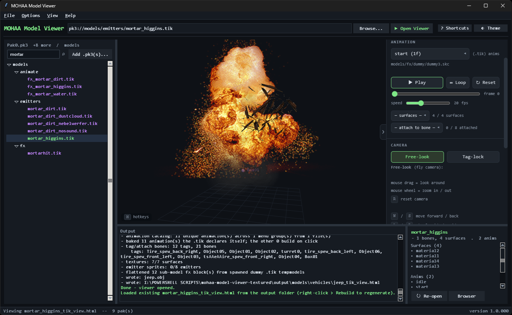 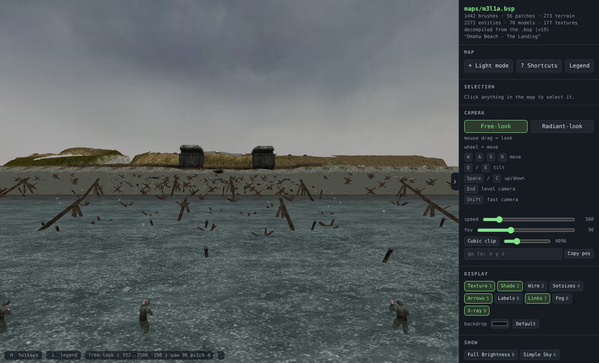

# Table of Contents

### [How To Install / Uninstall](https://github.com/searingwolfe/mohaa-model-viewer?tab=readme-ov-file#how-to-install--uninstall-1)<br>
## [MOHAA .tik Model Viewer](https://github.com/searingwolfe/mohaa-model-viewer?tab=readme-ov-file#mohaa-tik-model-viewer)<br><br>[MOHAA .bsp Map Viewer](https://github.com/searingwolfe/mohaa-model-viewer?tab=readme-ov-file#mohaa-bsp-map-viewer)<br><br>
### [Updating](https://github.com/searingwolfe/mohaa-model-viewer?tab=readme-ov-file#updating-1)<br>
### [Where Your Files Go](https://github.com/searingwolfe/mohaa-model-viewer?tab=readme-ov-file#where-your-files-go-1)<br>
### [Privacy & Security](https://github.com/searingwolfe/mohaa-model-viewer?tab=readme-ov-file#privacy--security-1)<br>
### [Licence & Legal](https://github.com/searingwolfe/mohaa-model-viewer?tab=readme-ov-file#licence--legal-1)<br>
### [For Developers](https://github.com/searingwolfe/mohaa-model-viewer?tab=readme-ov-file#for-developers-1)<br>
### [Contact & Credits](https://github.com/searingwolfe/mohaa-model-viewer?tab=readme-ov-file#contact--credits-1)

# How To Install / Uninstall

**Requirements** (the same for both viewers):

* **Python 3.8 or newer** (3.11+ recommended), with the `tkinter` GUI module.
* **Pillow 10.3 or newer**: required. MOHAA textures are `.tga` files, and nothing else decodes
  them. (Pillow 10.3 is also why Python 3.8 is the minimum.)
* A full copy of the game (and/or SH and BT expansions), for its `.pk3` files.
* Optional, Windows 8.1 and newer: allows for an embedded 3D pane instead of a browser tab
  (`pythonnet`, `pywebview==4.4.1`, `tkwebview2` and the Microsoft Edge WebView2 Runtime,
  which ships with Windows 10 and 11).
* Without the embedded pane, HTML pages auto-open in your browser. The Map Viewer needs WebGL 2 to work,
  which every current browser has, but the Model Viewer falls back to a 2D renderer without WebGL.

The packages are listed in [`docs/requirements.txt`](docs/requirements.txt). The RUN files
(`.bat` on Windows, `.sh` on Linux and macOS) check for all of these and install what's
missing **into the program's own `bin` folder** (`bin\libs`, `bin/libs-linux` or
`bin/libs-mac`), never into Python itself, so nothing else on your PC is changed and the
program keeps working when other software updates Python's packages.

## Windows

* Click the green `<> Code` button and choose `Download ZIP`. <br>
Extract the `mohaa-model-viewer-main` folder anywhere on your PC.

* Start either program with **`MOH Model-Map Viewer (Windows x86-x64).bat`**. A menu asks which one:
  press **1** for the **Map Viewer** (`.bsp` / `.map` / `.bak`) or **2** for the **Model
  Viewer** (`.skd` / `.tik`), or move with Up / Down and press Enter (the Map Viewer is
  selected at first); Q or Esc quits. Drag a file onto the `.bat` to skip the menu and
  open it straight away in the program for its kind.

  Before opening the program, it:
  1. looks for **Python 3.8 or newer with tkinter**. If there isn't one, it asks whether
     to install it now: **Y** runs `bin\python_installer_updater.bat` (below), **N** stops
     so you can install Python yourself from
     [python.org](https://www.python.org/downloads/) (tick "tcl/tk" in the installer);
  2. shows the menu (unless a file was dropped on it);
  3. installs **Pillow** into `bin\libs` if it's missing or older than 10.3 (required for
     textures), and checks that it really loads;
  4. installs the **embedded 3D pane** packages into `bin\libs` if they're missing
     (optional; on Windows 8.1 and newer);
  5. tells you if the Microsoft Edge WebView2 Runtime is missing, in which case pages
     open in your browser.

  The `.bat` window then starts the program and closes by itself as soon as its window is
  open. Everything it printed (the Python it found, the package checks, pip's output) is
  saved in `output\logs\run_map.log` / `run_model.log` and shown at the top of the
  program's Output pane. If the program can't start, the `.bat` window stays open, shows
  what went wrong and waits for a key press. (The full record is in `output\logs\`.) The
  Output pane also says each time the program saves a file ("saved <path>").

* **`bin\python_installer_updater.bat`** installs a Python that suits your Windows
version and CPU (Windows 7 → 3.8, Windows 8/8.1 → 3.11, Windows 10/11 → latest) for
your user account only, so it normally needs no administrator rights. It verifies the
installer's Authenticode signature before running it, then installs the packages into
`bin\libs`. The RUN `.bat` offers to run it for you, and you can also run it on its
own to refresh the packages to their newest versions. <br>
It deliberately **does not modify your `PATH`**: Python's own installer handles that,
and hand-editing the registry `PATH` is how environments often get broken.

* If Windows blocks a `.bat` (SmartScreen or Smart App Control): <br>
Right-click the `.bat` file → Properties → General tab → Security: [✓] Unblock → OK.

* Once a launcher is open, use File → `Add .pk3 pak(s)...` and select all the game's
`.pk3` files (Pak0.pk3 and up, plus any expansion or mod paks; later paks override
earlier ones). <br>
Models, maps, scripts and textures are spread across them, so load them all together.
Each viewer remembers its own list.

## macOS and Linux

Python's Tk toolkit is often a separate package; install it once:

```sh
sudo apt install python3-tk python3-pip   # Debian / Ubuntu / Kubuntu / Mint
sudo dnf install python3-tkinter          # Fedora / RHEL
sudo pacman -S tk                         # Arch
brew install python-tk                    # macOS (or use the python.org installer, which bundles Tk)
```

Then start either program with **`MOH Model-Map Viewer (Linux - Mac OS).sh`**, from a terminal
(Konsole, GNOME Terminal, macOS Terminal ...) or a Linux file manager (it opens a terminal
for itself if it has none). The same menu asks which one: **1** Map Viewer, **2** Model
Viewer, or Up / Down and Enter. Give it a file to skip the menu:

```sh
./"MOH Model-Map Viewer (Linux - Mac OS).sh"                     # the menu
./"MOH Model-Map Viewer (Linux - Mac OS).sh" maps/obj_team2.bsp  # straight into the Map Viewer
./"MOH Model-Map Viewer (Linux - Mac OS).sh" models/dog.tik      # straight into the Model Viewer
```

Like the `.bat`, it finds Python 3.8+ with tkinter and installs Pillow into
`bin/libs-linux` (`bin/libs-mac` on macOS) with `python -m pip install --target`. That
works on distributions that refuse system-wide `pip` installs (Ubuntu and Kubuntu 23.04
and newer), and it avoids Ubuntu 24.04's packaged Pillow 10.2, which is below the 10.3
security floor. If the `.sh` file won't start, make it executable:
`chmod +x "MOH Model-Map Viewer (Linux - Mac OS).sh"`. On macOS, Finder opens a double-clicked
`.sh` in a text editor, so start it from Terminal.

The embedded 3D pane is Windows-only. Everywhere else, pages open in your default
browser: same viewer, same output.

## Uninstall

Close both programs (each deletes its temporary workspace when it closes; File →
`Clear %temp% files` removes any left behind by a crash), then delete the folder.
Everything the programs keep is inside it: settings, logs and pages in `output/`
(see [Where Your Files Go](#where-your-files-go-1)) and the Python packages in `bin/libs*`.
Python itself stays installed; remove it from Windows Settings → Apps if nothing else
needs it.

# MOHAA .tik Model Viewer

A browser-based 3D asset viewer aiming at exact in-game visual parity across every asset
type the engine ships: skeletal models, animations, vehicles, weapons, projectiles,
static props, and the particle emitters and FX effects that existing tools do not handle.

Start it with **`MOH Model-Map Viewer (Windows x86-x64).bat`** and press **2** (or drag a `.skd` /
`.tik` onto it), load your `.pk3` archives, browse the model tree, and open any `.skd` or `.tik`
in a self-contained HTML viewer with animation playback, tag display, texture resolution
through the shader chain, and live particle effects.

## Why this exists

Plenty of tools open MOHAA's static geometry: vehicles, weapons and props load fine in
LightRay3D or Milkshape 3D. None of them show you a *running* asset: the particle
emitters, the FX scripts, the explosions, a skeletal model actually playing its animation
with its effects firing on the right frames. This viewer does, rebuilding each effect from
the `.tik` / `.shader` commands the way the engine would, so what you see on screen is
what the game draws.

## Features

**Loading & browsing**

* Open one or more `.pk3` archives and navigate the `models/` tree, or drag a
  loose `.skd` / `.tik` onto the launcher (or onto the RUN `.bat`).
* Loaded paks and preferences are remembered between sessions, with a
  recent-files list, tree search (`Ctrl+F`) and Explorer-style keyboard
  navigation.
* Select several files to build them in one batch, or drag a file out of the
  window to open it in its own browser tab.
* Right-click a file to open a `.tik` in your text editor, or a `.skd` in
  LightRay3D / Milkshape 3D (set them under Options → Change Text Editor /
  Change Legacy Model Viewer).
* Every built model is also exported as a Wavefront `.obj` you can open in other 3D tools.

**Rendering & animation**

* Skeletal `.skd` / `.skb` models with textures resolved through the full
  `.shader` chain, plus `.skc` / `.tik` animation playback: play/pause, loop,
  reset, per-frame scrub and a speed control.
* The animation browser follows the model's own `$include` / `includes{}`
  structure, so you can reach every anim the asset can play. The first 150 are
  built into the page (adjustable in Options); the rest are built the first time
  you pick them.
* **Particle emitters, FX scripts and explosions**, rebuilt from the effect
  commands and fired on their real frames: the part other tools skip.
* Show or hide individual surfaces, starting from what the `.tik` hides at spawn;
  an animation's own surface commands apply as it plays.
* Hang other models off any bone or tag with **attach-to-bone**, each with its
  own editable scale, offset (in `.tik` units) and angles. Its bone button moves
  it to another bone or tag and keeps those settings.
* WebGL rendering with a real depth buffer, or the 2D-canvas renderer (switch with
  View → Viewer renderer in the launcher, or Display → WebGL in the viewer; 2D is used
  automatically when WebGL isn't available).

On-demand animations and attach-to-bone need the launcher's embedded pane; a page
opened in a plain browser shows everything already built into it.

**Inspect & tweak**

* Display toggles: Texture, Mesh, Wire, Setsizes, Nodes, Labels, Face Anims,
  Corona orbit, WebGL and, for trees, the long-range Tree Sprite stand-in.
* **Edit a model's `setsize` bounding box live**: a pencil toggle on the setsize
  line turns the two `( x y z )` triples into number fields that redraw the red
  box as you type, then revert to the file's original values when you toggle it
  back off. A model with no `setsize` shows a `( 0 0 0 ) ( 0 0 0 )` placeholder
  you can fill in the same way.
* Copy the `setsize` line, or any attach-to-bone `scale / offset / angles` row,
  as one flat line in MOHAA `.tik` spacing, ready to paste straight into a
  script. Each attach-to-bone row's copy button gives the whole attachment as a
  script `attachmodel` line (model, bone, scale and offset).
* Free-look (WASD fly) and Tag-lock (orbit a clicked tag) cameras; tag/bone nodes
  and labels with a Tags-vs-Bones filter.
* An entity placement-angle (pitch / yaw / roll) dial that snaps to quarter
  turns, with a pencil for typing any angle.
* Light / dark theme and a custom backdrop colour, plus a full keyboard-shortcut
  set (`H` in the viewer, `F1` in the launcher).

**Self-contained by design**

* Each generated page is a single `.html` file: textures embedded as `data:`
  URIs, a restrictive Content-Security-Policy, and no network access at all
  (see [Privacy & Security](#privacy--security-1)).

## Model Viewer screenshots

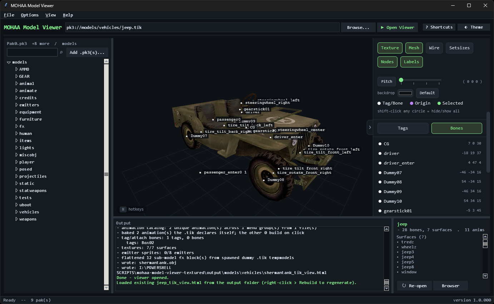
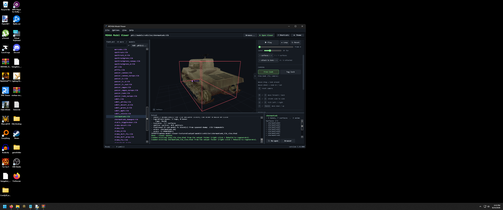
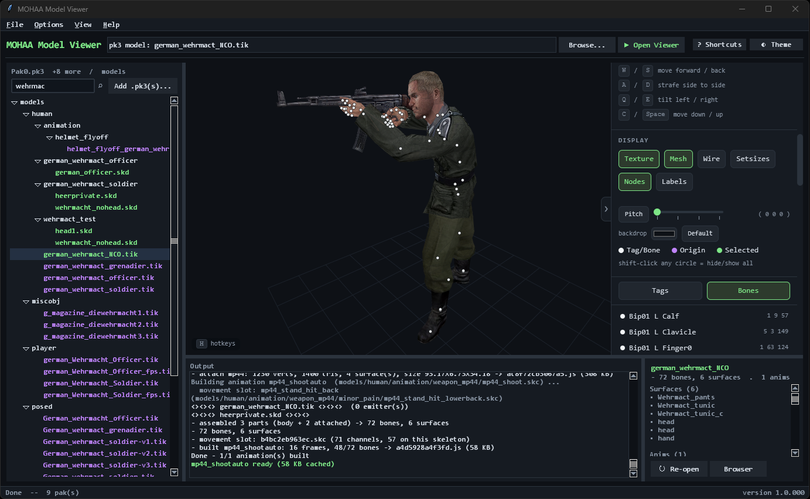
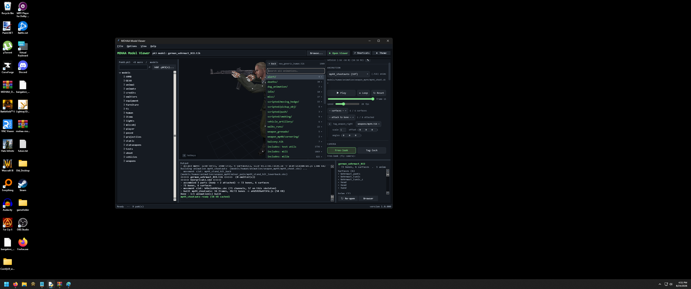
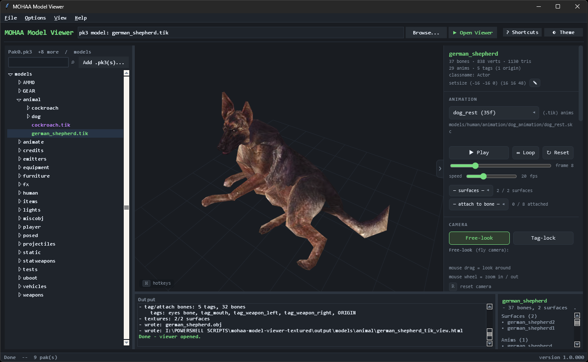
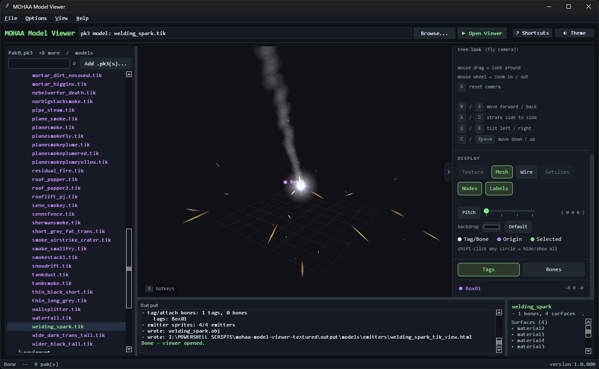

# MOHAA .bsp Map Viewer

**MOHAA Map Viewer** opens the game's maps. A compiled `.bsp` is decompiled back into
`.map` source and shown whole: textured, lit like the game, every entity one click away.
A `.map` source opens directly. It's a modern, view-only stand-in for MOHRadiant: nothing
is ever written back to a map.

Start it with **`MOH Model-Map Viewer (Windows x86-x64).bat`** and press **1** (or drag a `.bsp` /
`.map` / `.bak` onto it), add your `.pk3` paks, and open any map from the `maps/` tree (`dm`, `obj`, the
single-player levels), or a loose `.bsp` / `.map` / `.bak` from disk with File → `Open File...`.

## Why this exists

MOHRadiant, the game's level editor, only opens `.map` sources, and the game's maps, like
most custom maps, ship only as compiled `.bsp` files. This viewer turns any `.bsp` back
into `.map` source and lets you explore the map in a modern 3D view, the way the game
draws it or the way MOHRadiant does, with every entity, trigger, path node and brush one
click away: its targetname, origin, `setsize`, targets and ready-to-paste script lines.

## Features

**Opening maps**

* **`.bsp` and `.map`.** A compiled `.bsp` is turned back into `.map` source by a
  built-in decompiler: brushes with their texture alignment recovered from what the game
  actually draws, curved patches, terrain (with its cut-away holes), entities and static
  models. The `.map` is saved next to the page; a `.map` of your own next to a `.bsp` is
  never overwritten.
* **`.bak`** (MOHRadiant's previous save) opens like the `.map` or `.bsp` it holds; what it
  writes has `_bak` in its name, so it never replaces the real map's page or decompile.
* Right-click a `.bsp` → **Decompile to .map only**, or decompile and open the `.map` in
  your text editor. A map's `.scr` scripts are in the tree too: double-click one to open
  it in your text editor.
* A page is rebuilt by itself when a loose file it was built from changes: the map
  opened from disk, or its `.scr`, `.dcl`, `.lin` or `.pth`.
* Select several maps, or right-click a folder, to build them in one batch.

**Seeing the map**

* **The whole map, textured:** brushes, curved patches, LOD terrain, placed and static
  models, and every entity, with point entities drawn the way MOHRadiant draws them
  (path nodes coloured by their targetname and spawnflags, facing arrows, stand-in cubes).
* **Lit like the game:** a `.bsp` opens with its own lightmaps, vertex light, baked
  static-prop light, light-grid model colours and sky box (with its moving cloud
  layers), so you see what a player sees. **Full Brightness** (`B`) switches to
  MOHRadiant's flat, fully bright look. The sky is drawn behind everything, as in game;
  **Simple Sky** (`K`) shows MOHRadiant's solid, tiled sky brushes instead, and the
  **Sun flare** (`J`) is drawn the way the game draws it.
* **Lights off** (`0`) turns every light off, or just the selected ones, and **Sun
  light** (`-`) takes the sun and sky out of the baked light, so you can see what each
  light gives the map.
* **Weather** (`Y`): the map's rain and snow, made the way the game makes it in its Rain
  (`func_rain`) brushes, beam limit and all (a map without any falls from its sky instead,
  never indoors), with every setting in the game cvars (speed,
  size, slant, density, shader, the client's frame rate, Allied Assault 1.11 or OpenMoHAA
  behaviour) and presets (`cg_weather snow`, `rain`, `blizzard` ...). `cg_thunder` adds the
  lightning flashes of the game's weather script, and the trees' leaves sway as in game
  (`r_static_shadermultiplier1` for how far).
* **Decals** (`=`): the map's permanent `.dcl` decals (signs, cracks, numbers), lit as
  the game draws them.
* **Leak trail** (`P`): when a map leaks, the compiler's `.lin` trail is drawn through
  walls from the void to the entity it reaches; the place it gets in is worked out and
  marked (the gap's size and the brushes either side), and its card says how to fix it.
* **Level script entities** (Show → Script ents, `Ctrl+E`): what the map's `.scr` (and
  the map scripts it runs) spawns: waypoints and their `target` paths (set in loops
  too), script models and origins, actors, placed where its lines say, with the threads it
  runs read for the entity they run on (a bipod spawned under each gun). The map's stats line opens the list, with
  its `setcvar` and `$world` lines. Scripts are found as the game finds them: a loose
  `main/maps/<map>.scr` before the paks. A trigger the script spawns with a `setsize`
  (also one given through fields of the script's own, `local.t.setsize1 = ( ... )` then
  `local.t setsize local.t.setsize1 local.t.setsize2`) is a small marker under Script
  ents, and **Show → Script trigs** draws its volume, see-through like a trigger brush
  (hidden by the In-game look).
* **Open door** (`O`) opens and closes doors as the game does.
* **Run exploder** sets off an exploder's `#set` as `global/exploder.scr` does: the
  building goes and its chunks fly toward their targets, land and sink away. **Reset
  exploder** puts it back.
* **Simulate**: select an `info_splinepath` and press **Simulate** to fly a model along
  its path the way a script's `followpath` does: from the path's first node, through each
  node's origin, angles (it banks) and `speed`, at the game's own pace. **Choose...** picks
  the model (any `.tik` in the loaded paks, with a search box; a box with a nose until
  one is picked), **Reset** stops it, **Follow** rides along behind it (with **Eye view**
  too, at its own angles, banking with it), and **camera zoom** (or the mouse wheel)
  sets how far behind. Move or edit the nodes in Modify and simulate again to see the change.
* **Modify** (above Find): add entities, most of all AI path nodes: Add, then click on the
  map where it goes. A new node is drawn
  see-through until saved, its parameters edit as entity-lump text (applied as you type),
  **Move** picks it up again with the mouse, **Trim origin** nudges it with W A S D / the arrows by a trim step of 1 to 50 units
  while the camera stays put, and **AI routes** show its links as soon as it is placed,
  worked out the way the game builds its `.pth`. **Save as .bsp** writes a copy of the
  map with the new entities and a new `map_time`, so the game rebuilds its paths; it
  never writes over the original. **Save as .map** and **Copy** are there too. Closing the
  viewer with Esc while changes aren't saved asks first: Save as .bsp, Save as .map,
  Discard changes or Cancel. Selecting one of the map's own point entities (a broken
  path node, say) lists it in Modify too, to edit, move or trim it the same way. **Make path**
  sets the selected entity's `target` by clicking the next one (waypoints, spline paths,
  script origins), drawn as a target link. **Grid** (+) draws a see-through 3D grid of MOHRadiant's sizes (1 to 512)
  that Add and Move snap to.
* **Game cvars** (`` ` ``): the game's debugging cvars, working in the page:
  `r_showtris`, `r_farplane`, `ai_showroutes` (from the map's `.pth`, or worked out when it has none), `sv_showentnums`,
  `sv_showbboxes`, `g_entinfo`, `r_lightmap` and more; Reset at the top of the list sets them all back.
* **MOHRadiant-style filters** (`Alt+1` … `Alt+0`, `Ctrl+D / H / M / R / T / P / K`) for
  caulk, clips, triggers, hints, AI nodes, lights, details, terrain, sky and more, with
  **In-game look** and **Editor look** presets, plus setsize boxes, target arrows,
  labels, X-ray, fog and cubic clipping.
* **Legend** (`L` in the viewer, `F2` / Help → Legend in the launcher): what every
  colour, marker, path-node border and editor brush (clip, trigger, hint, vis,
  areaportal...) means.

**Moving and finding**

* **Two cameras:** Free-look (the Model Viewer's WASD fly, with `Q` / `E` tilt) and
  **Radiant-look**, which flies with MOHRadiant's own keys and right-drag. `V` switches
  between them.
* **Click anything:** a face, brush, patch, model or entity. `N` or `Ctrl+click` opens
  its card: every key, origin, angles, targets and targetnames, spawnflags, the
  `setsize` (taken from its brushes for triggers and doors) and ready-to-paste script
  lines. `Alt+click` selects everything of the same kind, `Ctrl+Alt+click` a whole path
  (a node's `target` chain, before and after it), and `Ctrl+Shift+click` shows a face's
  texture.
* **Find** any class, targetname, key or texture (`Ctrl+F`), with `"exact"`, `$targetname`,
  `key: value`, `entity 25`, `( x y z )` and `-term` searches, or browse every class and
  texture the map uses; Shift+click a green (selected) row to deselect just that row.

It uses the same Python and packages as the Model Viewer, and both can be open at once.
Press `H` in the viewer or `F1` in the launcher for every shortcut.

**Planned:** following more of what a level script does as it runs (moving and removing
the map's own entities).

## Map Viewer screenshots

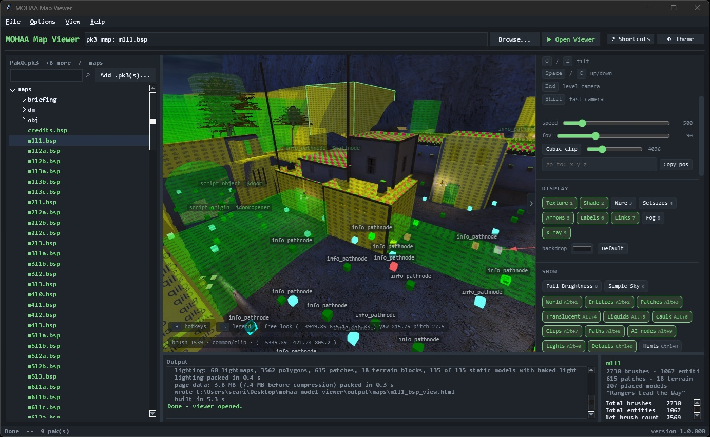
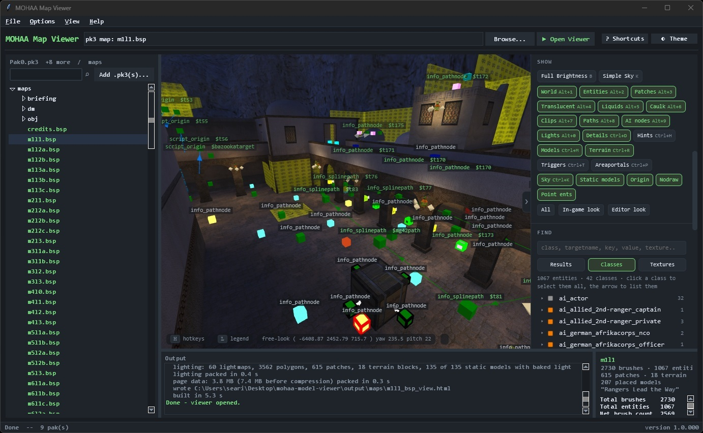
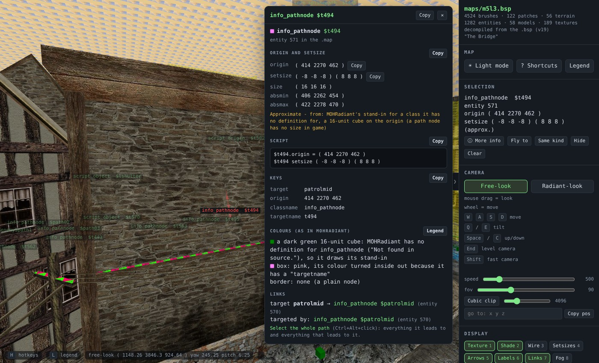
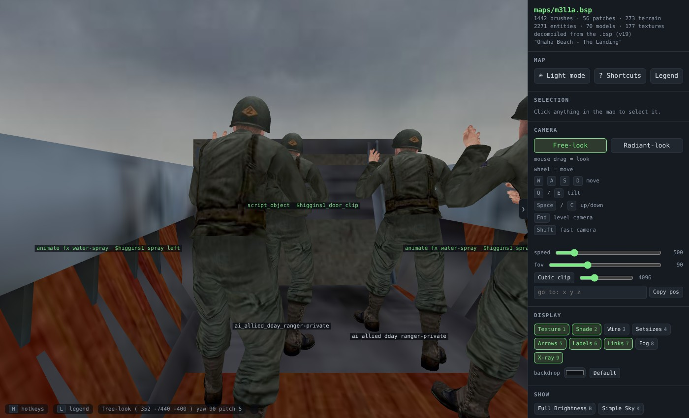
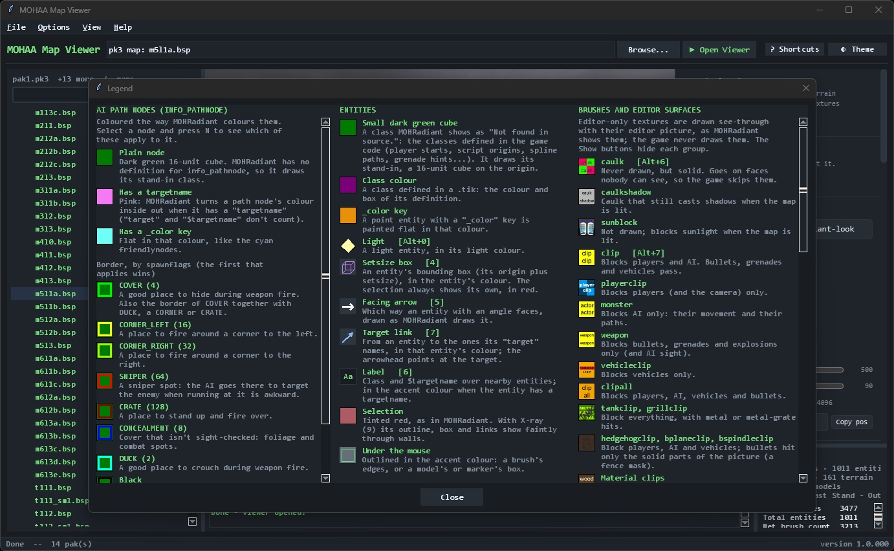
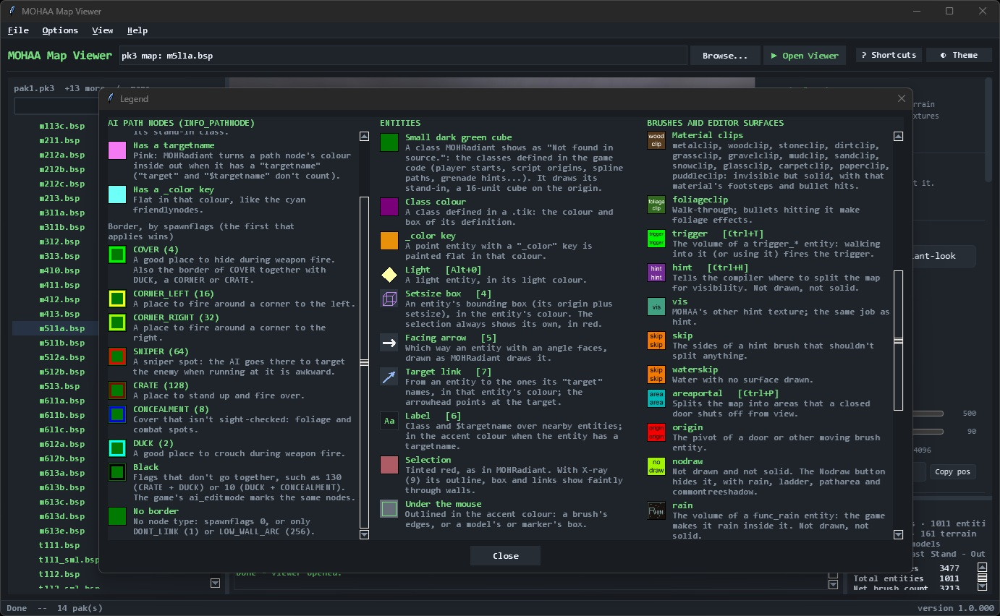
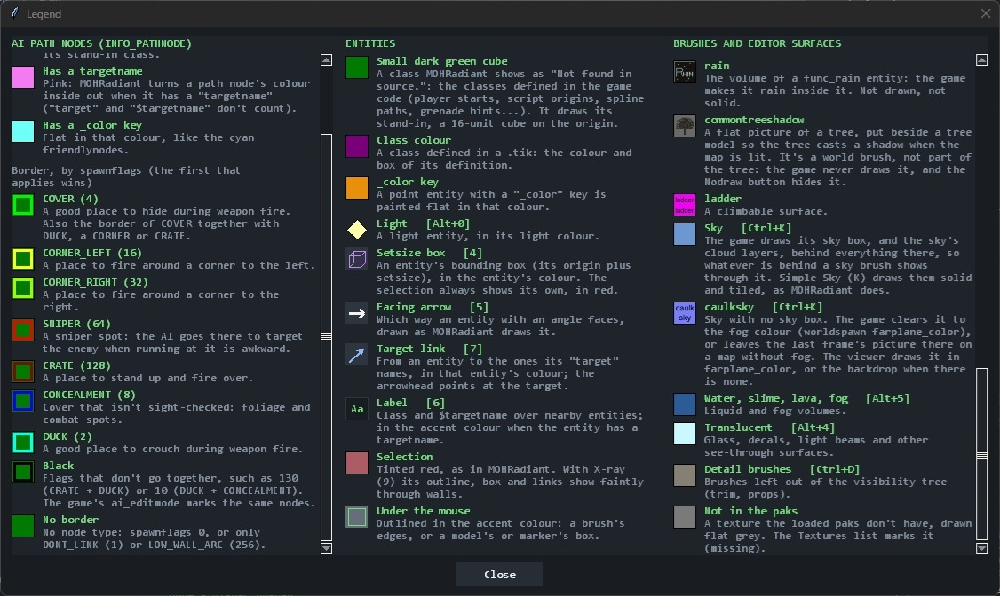

# Updating

**Help → Check for updates** (in either launcher) compares your version with the latest
one in this repository and, if you choose, downloads the new version, installs it over the
program folder, and restarts. Both viewers update together, since they share the folder.
Your settings and built pages in `output/` and the packages in `bin/libs*` are left alone.

The update is checked before anything changes: the download must be undamaged and must
really be the version offered. Every file it replaces is copied first to
`output/previous-versions/<n>/` (one numbered folder per update, listed in
`output/previous-versions/changelog.txt`), and if any file can't be written, the files
already replaced are put back and the update reports what failed. Files the new version
no longer has (such as the old per-program RUN launchers, now one `MOH Model-Map Viewer`
file per system) are copied there too, then removed. To go back a version,
copy a numbered folder's contents over the program folder.

# Where Your Files Go

| | Model Viewer | Map Viewer |
|---|---|---|
| Settings | `output/mohaa_viewer_config.json` | `output/mohaa_map_viewer_config.json` |
| Console log | `output/output_console.log` | `output/output_console_map.log` |
| Built pages | `output/models/`, mirroring the pak's folders; files opened from disk go to `output/standalone/` | `output/maps/`, with each decompiled `.map` beside its page; files opened from disk go to `output/maps_standalone/` |
| Scratch space | a `mohaaview_*` folder in your system temp folder | a `mohaamap_*` folder in your system temp folder |
| Program logs | `output/logs/mohaa_launcher.log` and `mohaa_view.log` (page builds) | `output/logs/mohaa_map_launcher.log` and `mohaa_map_view.log` (page builds) |
| Settings backups | `mohaa_viewer_config.json.bak` beside the settings | `mohaa_map_viewer_config.json.bak` beside the settings |
| Previous versions | `output/previous-versions/<n>/` (written by Help → Check for updates, shared) | (same) |
| Python packages | `bin/libs` (Windows), `bin/libs-linux` (Linux), `bin/libs-mac` (macOS), shared | (same) |

`output/` is the folder next to `bin/` (in a flat / portable install, the scripts' own
folder). The built-pages folder can be changed under Options. On Windows, the embedded
pane also keeps its browser files in `output/webview2/`.

The logs are a timestamped record of what each part did, including every error with its
technical details (each file is capped at 2 MB, with five older copies kept). **Options →
Open log folder** shows them; please attach the relevant one when you report a bug. The
console log keeps the previous launch's copy with `.prev` in its name.

Settings are saved safely: each save keeps the previous file as `.bak`. If a settings file
is ever damaged (or hand-edited with `C:\...` paths, which JSON can't hold), the program
repairs it, or restores the `.bak`, or sets the damaged file aside as `.corrupt-<date>`,
and says which in the Output pane. **Options → Reset settings...** forgets every saved
choice, including the pak list the two viewers share (keeping `.bak` copies), and restarts the program.

**File → Clear built models** (or **Clear built maps**) and **Clear %temp% files** remove
the built pages and the scratch space. Clear built maps deletes only the pages and `.map`
files the Map Viewer wrote: a decompile never replaces a `.map` of your own (it's saved
as `<name>_decompiled.map` instead).

# Privacy & Security

**Neither program collects or sends anything.** No telemetry, no analytics, no crash
reporting, and nothing is ever checked or sent automatically. Everything happens on your
machine.

They use the network only when you ask: **Help → Check for updates** reads a small version
file from this repository and, if you choose, downloads the newer files from GitHub. (The
RUN files also install missing Python packages from pypi.org into `bin/libs*`, and on
Windows the Python installer they offer downloads Python from python.org if you say yes.) Full
notice: [`PRIVACY.md`](docs/PRIVACY.md), or **Help → Privacy & Legal** inside either
program.

`.pk3` files are ordinary ZIP archives, and downloaded ones, like downloaded maps, should
be treated as untrusted input. Both programs are hardened accordingly: archive paths are
confined to their workspace, model and `.bsp` headers are bounds-checked, parsers are
protected against decompression and expansion bombs (oversized images included), Pillow
older than the 10.3 security floor is refused, and generated pages escape game-file text
and carry a restrictive Content-Security-Policy.

Found a hole? See [`SECURITY.md`](docs/SECURITY.md). **Please report privately, not in a
public issue**, and please don't attach copyrighted game assets to reports.

# Licence & Legal

Released under the **GNU General Public License v2**; see [`LICENSE`](LICENSE).

Engine behaviour is verified against [OpenMoHAA](https://github.com/openmoh/openmohaa),
which is GPLv2. [`THIRD_PARTY_NOTICES.md`](docs/THIRD_PARTY_NOTICES.md) explains that
relationship and lists every dependency's licence.

*Medal of Honor* and *Medal of Honor: Allied Assault* are trademarks of their
respective owners. This is an unofficial, non-commercial fan project. It is
**not affiliated with, authorised, sponsored or endorsed by Electronic Arts Inc.**
or any other rights holder. Those names are used only to identify the game whose
file formats these tools read.

**No game assets are distributed with this project**, and none may be committed
to it. You must supply your own copy of the game. Do not redistribute extracted
game content. A decompiled map still belongs to whoever made it: don't publish one
without its author's permission.

# For Developers

Project notes live in [`docs/changelog/`](docs/changelog/README.md): the
[changelog](docs/changelog/CHANGELOG.md), an
[architecture overview](docs/changelog/project-overview.md) with known issues,
the [development workflow](docs/changelog/development-workflow.md),
[engine notes](docs/changelog/engine-notes.md), a reference of every
[emitter command](docs/changelog/emitter-commands.md) the Model Viewer supports, and
the [Map Viewer notes](docs/changelog/map-viewer.md): the decompiler, the page, the
game's lighting, the cameras and known limits, with notes on
[doors](docs/changelog/doors-notes.md) and the
[game cvars](docs/changelog/game-cvars-candidates.md). The source code cites the exact
OpenMoHAA files and lines it follows. How the code is hardened (logging, atomic writes,
settings recovery, the vendored packages, the updater) and the decisions behind it are in
[hardening notes](docs/changelog/hardening-notes.md).

Checks to run before shipping, from the project folder (they need tkinter):

```sh
python tests/test_hardening.py      # regression tests for the hardening pass
python tests/check_batch_files.py   # CRLF, no ">" inside quotes, a single pause
python tests/check_privacy_sync.py  # PRIVACY.md = PRIVACY_TEXT = _PRIVACY_SWAPS
python tests/check_init_attrs.py    # MapApp.__init__ keeps up with App.__init__
python tests/fuzz_parsers.py bin 1  # corrupted-input fuzz of every file parser
```

# Contact & Credits

Bugs, questions and suggestions: [open an issue](https://github.com/searingwolfe/mohaa-model-viewer/issues).
Security problems: report privately as described in [`SECURITY.md`](docs/SECURITY.md).

Made by **Searingwolfe**.

Engine reference: the [OpenMoHAA](https://github.com/openmoh/openmohaa) project. <br>
Map decompiling approach: wfowler1's [BSP Decompiler](https://developer.valvesoftware.com/wiki/BSP_Decompiler_005) (LibBSP). <br>
Without the game's raw code, matching the original renderer would not have been possible.
